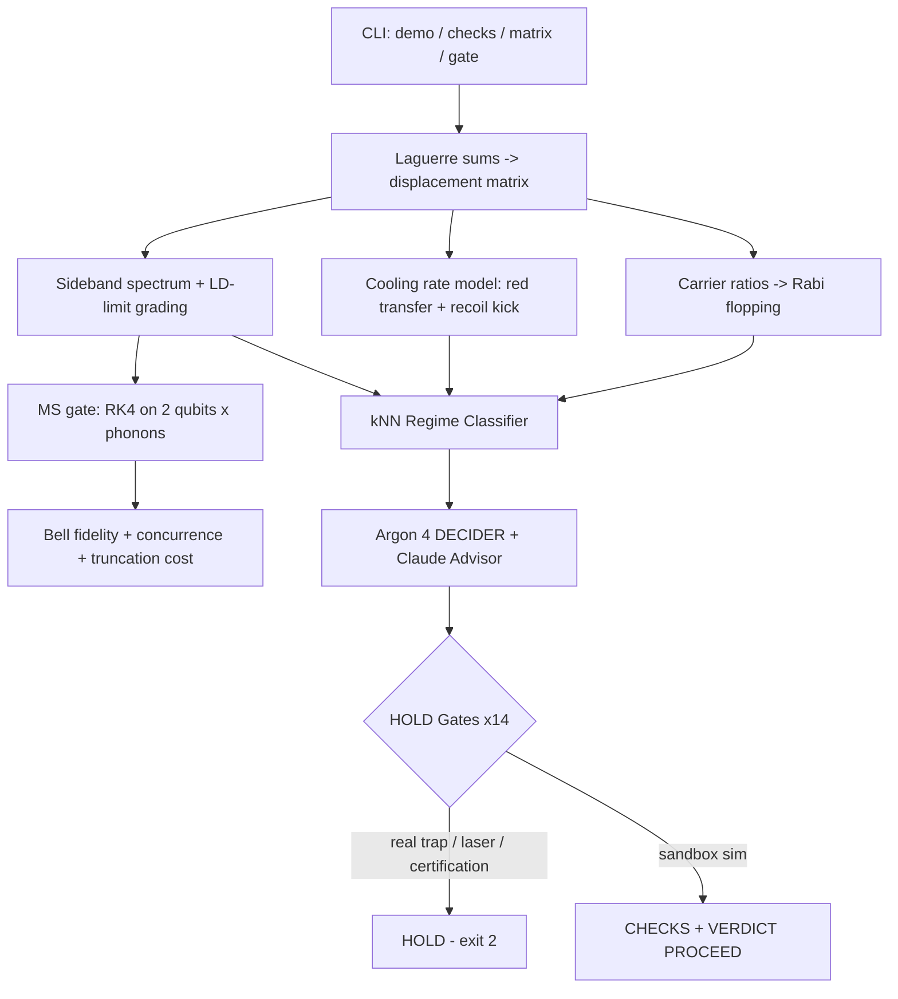
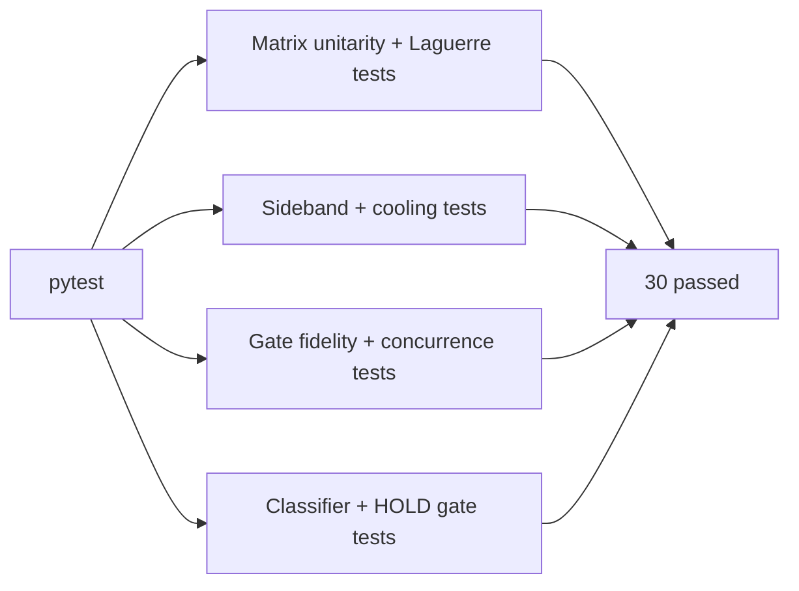
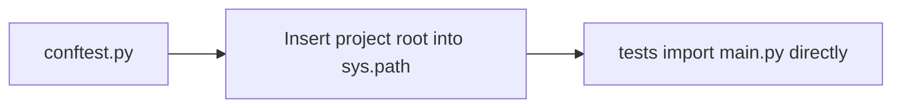
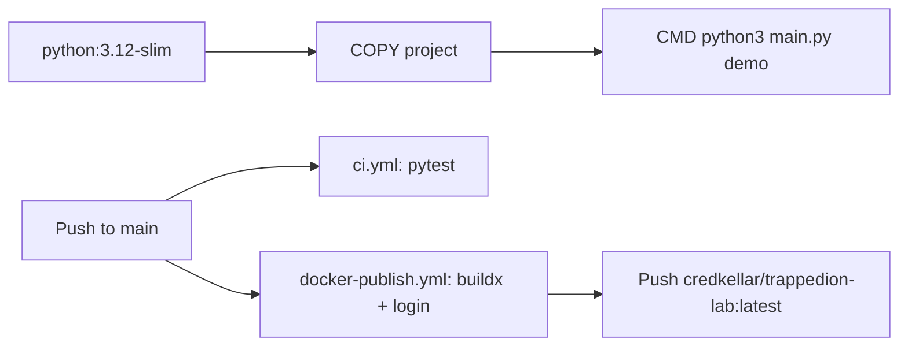

# TrappedIon-Lab 🪤⚛️

**Trapped-Ion Physics Lab — Lamb-Dicke Sidebands, Sideband Cooling & the Mølmer–Sørensen Gate** — by Darion Kellar

TrappedIon-Lab is an **educational trapped-ion physics lab** in ONE pure-Python file. It builds the whole single-ion toolbox from scratch, starting from the one matrix that everything else stands on:

- **The displacement matrix** ⟨n′|exp(iη(a + a†))|n⟩ — computed by the exact Laguerre summation, row-unitary to **1.3e-15**, for η ∈ {0.05, 0.1, 0.2, 0.5, 1.0}. 🔢
- **The sideband spectrum** — carrier, red and blue Rabi ratios from those elements, graded against the Lamb–Dicke-limit scalings: honest at η = 0.05 (max error **1.15e-03**), visibly broken at η = 0.5 (max error **0.8632**, and the carrier approximation goes *negative*). 📊
- **Resolved-sideband cooling** — a rate model on phonon populations that walks a thermal n̄ = 5 ion down to **n̄ = 0.005277**, on the η²/2 floor — while carrier-only driving, run through the same bookkeeping, moves n̄ by exactly **zero**, because Δn = 0 cannot cool. ❄️
- **A two-ion Mølmer–Sørensen gate** — RK4 on 2 qubits × phonon levels, producing a computed Bell state: **F = 0.988444, concurrence = 0.976935** in the advertised 0..3 phonon space, with the 0..7 reference run (F = 0.999998) printed beside it so the **truncation cost (ΔF = 0.011554) is a number, not a footnote**. 🔗
- **Rabi flopping** — a pure n = 0 state flips at full contrast forever; the thermal mixture's peaks decay **0.9879 → 0.5812** as the n-spread of carrier rates washes the contrast out. 🎚️

Honest scope, stated up front: every parameter is a **labelled teaching number** — a ⁴⁰Ca⁺-like ion, a 1 MHz trap, a 729 nm laser (the set is self-consistent: it implies η = 0.096879). **No ion was trapped, cooled, or entangled.** Every hardware, laser, certification, and advantage claim sits behind a permanent HOLD gate (14 total). 🔒

[](https://github.com/kimanicollier44-cmyk/TrappedIon-Lab/actions/workflows/ci.yml)
[](https://github.com/kimanicollier44-cmyk/TrappedIon-Lab/actions/workflows/docker-publish.yml)

> ℹ️ These are the **live** workflow badges for this repo. They activate as soon as the `ci.yml` and `docker-publish.yml` files from the paste pack are pasted into `.github/workflows/` — until then they have nothing to report yet.

## 🧰 Tech Stack Badges & Full Architecture Tech Stack

### 💻 Core Programming Languages & Core Systems


- 🐍 Python 3.12, pure standard library (`cmath`, `math`, `hashlib`, `json`, `sys`) — zero dependencies, zero network, deterministic (double-run byte-identical)
- 🔢 Displacement core from scratch: generalised Laguerre polynomials by their exact finite sum, giving every ⟨n′|exp(iη(a + a†))|n⟩ — row unitarity Σ|M|² = 1 asserted to <1e-9 for all five η values before any spectrum is trusted
- 📊 Spectrum + cooling core: carrier / red / blue ratios read off the matrix, the Lamb–Dicke scalings graded against them, and a rate model on p_n (n ≤ 20) whose transfer rates and repump recoil kernel are both built from the same exact elements
- 🔗 Gate core: the Mølmer–Sørensen interaction-picture Hamiltonian applied by index arithmetic on a 2-qubit × phonon statevector, integrated with RK4; concurrence by Wootters' formula with a from-scratch Hermitian eigensolver (real-embedding Jacobi)
- 🧠 TinyML kNN regime classifier (from scratch, stdlib, distance-weighted): lamb-dicke-resolved / lamb-dicke-marginal / unresolved-sideband / beyond-lamb-dicke from (η, Ω₀/ω, n̄), labels from the lab's own policy
- 🪑 Council seats: Gemini Argon 4 DECIDER (names-only, tighten-only) + Muse advisor (never overrides HOLD) + Google Flow plan-only (rendered = False, live = 0)

### ⛓️ Web3 & Infrastructure

- 🚫 **Not applicable — honestly.** No blockchain, no Web3, no tokens: the "infrastructure" in this lab is one offline file holding a harmonic oscillator, a laser coupling, and two simulated ions. No fake badges here.

### ⚙️ Platform Support & Hardware Architecture


- 🖥️ Pure Python — runs anywhere Python 3.12+ runs (Linux, macOS, Windows), plus the `python:3.12-slim` Docker image
- 🔒 No hardware is controlled, ever: real traps, lasers, vacuum systems, and control electronics are permanent HOLD gates (see the gate table below)

### ⚡ Low-Level Infrastructure & Performance

- 🚫 **No low-level code — honestly.** No C, no C++, no GPU, no compiled extensions: this is one interpreted Python file on purpose, so every matrix element can be read, checked, and diffed. Performance here means honest algorithms — exact finite sums instead of special-function calls, an RK4 integrator whose step count is printed, and a gate run twice in two Hilbert spaces so the truncation error is measured, not guessed.

### 🛠️ DevOps & Build Tools


- 🐳 Docker (`python:3.12-slim`), GitHub Actions CI + Docker Publish (delivered in the paste pack)
- 🎯 Target image: `credkellar/trappedion-lab:latest`
- 🧪 Tests: `pytest` (30 tests) + the built-in CHECKS suite (52 checks) in `main.py`

### ☁️ Cloud Providers

- 🚫 **None — honestly.** No cloud provider is used or needed: the lab runs fully offline on your own machine or in a local Docker container. Docker Hub appears only as the registry the publish workflow pushes the image to.

## What this does?

1. 🏷️ **Labelled ion, self-consistent parameters** — a ⁴⁰Ca⁺-like ion (40 amu) in a 1 MHz trap driven at 729 nm: the ground-state extent is x₀ = **11.240 nm**, so the labelled set *implies* η = kx₀ = **0.096879** — the teaching value η = 0.1 is a rounding of a computed number, not an invention.
2. 🔢 **Displacement matrix by exact summation** — generalised Laguerre L_n^k(x) evaluated by its defining finite sum, assembled into ⟨n′|exp(iη(a + a†))|n⟩ for η ∈ {0.05, 0.1, 0.2, 0.5, 1.0}; every row n ≤ 12 sums |M|² to 1 with worst deviation **1.33e-15**.
3. 📊 **Sideband spectrum** — carrier / red / blue Rabi ratios Ω/Ω₀ = |M| tabulated for n = 0..8: at η = 0.1 the carrier slides 0.995012 → 0.916795 (the Debye–Waller factor), the blue sideband grows 0.099501 → 0.286702, and the red sideband from n = 0 is **exactly 0**.
4. 🎯 **Lamb–Dicke limit, graded** — the textbook scalings (carrier ≈ 1 − η²(n + ½), red ≈ η√n, blue ≈ η√(n+1)) are checked against the exact elements: max error over n ≤ 6 is **1.15e-03 at η = 0.05** but **0.8632 at η = 0.5**, where the carrier approximation for n = 6 reads **−0.625** against the exact +0.071430 — the approximation doesn't just drift, it leaves physics.
5. ❄️ **Resolved-sideband cooling toy** — 400 cycles of red-sideband transfer (rates from the exact |M(n→n−1)|²) plus one direction-averaged repump recoil kick per cycle (axial η²/2): n̄ walks **4.533386 → 3.7161 → 3.0320 → 1.6078 → 0.4894 → 0.005277** and stops there — the floor *is* the η²/2 = 0.005 scale, with ground population **0.994739**.
6. 🚫 **Carrier-only contrast** — the same bookkeeping with the transfer set to the identity: n̄ goes 4.533386 → **4.533386**. The carrier matrix element is diagonal in n, so it flips the internal state and removes nothing; the sim states this instead of letting a cooling curve imply otherwise.
7. 🔗 **Mølmer–Sørensen gate, integrated** — the bichromatic interaction-picture Hamiltonian H(τ) = (g/δ)(σ_x1 + σ_x2)(a e^(−iτ) + a† e^(+iτ)) with g/δ = 0.25 (g/2π = 5 kHz, δ/2π = 20 kHz, one closed loop, 50.0 µs), RK4 on 2 qubits × phonon levels from |00⟩|0⟩.
8. 🏷️ **A computed Bell state, priced honestly** — after the loop the motion disentangles and the spins land on (|00⟩ + |11⟩)/√2 (up to a labelled virtual-Z frame correction on ion 2): in the advertised 0..3 phonon space **F = 0.988444, concurrence = 0.976935**; in the 0..7 reference space **F = 0.999998, C = 0.999996**. The difference — **ΔF = 0.011554, ΔC = 0.023061** — is reported as the truncation cost.
9. 🎚️ **Rabi flopping and contrast collapse** — the n = 0 π-time is **5.025 µs** at the labelled Ω₀; the pure state peaks at 1.000000 at every odd multiple of t_π while the thermal (n̄ = 5) peaks decay **0.987931, 0.908213, 0.808783, 0.677182, 0.618153, 0.581209** — the carrier-rate spread (0.995012 down to 0.945758 by n = 5) made visible.
10. 🏷️ **Regime classifier + seats + checks** — a from-scratch distance-weighted kNN labels working points lamb-dicke-resolved / marginal / unresolved-sideband / beyond-lamb-dicke (the labelled Ca⁺ headline: resolved, before *and* after cooling; a strong blur drive: unresolved; a heavy hot ion: beyond), with Argon 4 DECIDER (sha256 trace), Muse advisor, Google Flow plan-only, and a built-in CHECKS suite (52 checks).

## 🗺️ How it works — diagram per script

### `main.py` — the whole lab



### `tests/test_main.py` — verification



### `conftest.py` — test path setup



### `Dockerfile` + CI flow — container & publish



## Why is this cool?

1. 🔢 The Lamb–Dicke parameter isn't typed in — it's **derived**: mass, trap frequency and wavelength go in, η = 0.096879 comes out, and the round teaching value is labelled as a rounding.
2. 🧮 The displacement matrix is **summed, not imported**: Laguerre polynomials from their defining finite sum, then unitarity verified to 1.3e-15 — the foundation is proven before anything is built on it.
3. 📉 The Lamb–Dicke approximation is shown **failing on camera**: at η = 0.5 its carrier prediction goes negative (−0.625 vs exact +0.071) — you watch a textbook shortcut leave physics, with the error printed at both ends.
4. ❄️ The cooling floor is **emergent, not scripted**: the sim stops at n̄ = 0.005277 because the recoil kick's η²/2 heating balances the sideband removal — the famous limit falls out of the bookkeeping.
5. 🚫 The carrier-only run is the control experiment most demos skip: same code, Δn = 0, n̄ moves by **exactly zero** — the reason sidebands exist, demonstrated.
6. 🔗 The entangling gate is a **real integration**: 720 RK4 steps of a time-dependent Hamiltonian, not a quoted unitary — and the Bell state it produces is measured (fidelity + concurrence), not asserted.
7. 🏷️ The truncation cost is a **headline number**: F = 0.988444 in the 0..3 space vs 0.999998 in the 0..7 space, difference printed — the lab grades its own approximation.
8. 🎚️ Contrast collapse is **computed from the distribution**: the thermal flopping peaks decay 0.988 → 0.581 because each n flops at its own Debye–Waller rate — no decoherence is inserted by hand.
9. 🎯 The red sideband's zero at n = 0 does double duty: it's a matrix element, a CHECKS assertion, *and* the reason ground-state cooling has a floor to land on.
10. 🔁 Deterministic end to end: run it twice, get byte-identical output — an ion trap you can diff.

## What problems this solves?

1. ❌ **Problem:** Lamb–Dicke η is usually quoted as a vibe ("small"). ✅ **Solution:** It is computed from the labelled mass / trap / wavelength set (η = 0.096879), and the exact matrix shows precisely how small is small enough.
2. ❌ **Problem:** Sideband strengths get read off a formula nobody checks. ✅ **Solution:** Every ratio is an exact matrix element, and the LD scalings are graded against them at five η values with the errors printed.
3. ❌ **Problem:** "Sideband cooling reaches the ground state" is stated without the floor. ✅ **Solution:** The rate model lands at n̄ = 0.005277 and shows the balance that stops it there — recoil η²/2 per cycle against sideband removal.
4. ❌ **Problem:** Cooling demos imply any strong drive cools. ✅ **Solution:** The carrier-only control run moves n̄ by exactly 0.000000 — Δn = 0 cannot cool, in numbers.
5. ❌ **Problem:** Gate fidelities are quoted without the Hilbert space they were computed in. ✅ **Solution:** The gate runs in two spaces and the truncation cost (ΔF = 0.011554) is a printed output, not a caveat.
6. ❌ **Problem:** Entanglement gets claimed from amplitudes by eye. ✅ **Solution:** Concurrence is computed by Wootters' formula with a from-scratch eigensolver that is itself tested on Bell (C = 1), product (C = 0), and classically-mixed (C = 0) states.
7. ❌ **Problem:** Rabi flopping is drawn as a perfect sine for every ion. ✅ **Solution:** The thermal curve is the honest sum over the distribution; its peaks decay 0.988 → 0.581 while the pure state's stay at 1.000.
8. ❌ **Problem:** Labelled teaching parameters quietly become "specs". ✅ **Solution:** Every parameter is labelled, `hardware_specification_claim` and `simulation_as_measurement_claim` are permanent HOLD gates, and the README says what was not measured.
9. ❌ **Problem:** Regime labels (resolved / marginal / beyond-LD) are applied by feel. ✅ **Solution:** A policy defines them from (η, Ω₀/ω, n̄), a kNN interpolates the policy, and CHECKS asserts the classifier matches the policy on all 336 grid points.
10. ❌ **Problem:** Simulation tools quietly imply hardware is next. ✅ **Solution:** 14 named HOLD gates return exit code 2 for every trap-control, laser, certification, and advantage claim, forever.

## How to install this?

1. 📋 Clone or download this project folder.
2. 🐍 Make sure Python 3.12+ is installed: `python3 --version`
3. ▶️ Run the full demo + checks (no arguments needed):

```bash
python3 main.py
```

4. 🧪 Run the test suite:

```bash
pip install pytest
python3 -m pytest -q
```

5. 🎛️ Try the other commands:

```bash
python3 main.py checks     # 52 built-in checks
python3 main.py matrix     # displacement matrix + unitarity report (JSON)
python3 main.py sidebands  # sideband spectrum + Lamb-Dicke grading (JSON)
python3 main.py cooling    # cooling run + carrier-only contrast (JSON)
python3 main.py gate       # MS gate: fidelity, concurrence, truncation cost (JSON)
python3 main.py rabi       # Rabi flopping: pure vs thermal peaks (JSON)
python3 main.py classify   # kNN regime classifier report
python3 main.py brains     # Argon 4 + Muse + Flow seats
python3 main.py holds      # list all 14 HOLD gates
python3 main.py hold-demo  # exits 2 - gated actions stay HOLD
```

6. 🐳 Or run it in Docker:

```bash
docker build -t credkellar/trappedion-lab:latest .
docker run --rm credkellar/trappedion-lab:latest
```

## Requirements

- 🐍 Python 3.12 or newer
- 📦 Dependencies: **none** (standard library only)
- 🌐 Network: **none** — fully offline
- 🧪 For tests only: `pytest`
- 🐳 Optional: Docker

## FULL project structure tree

```text
trappedion-lab/
├── main.py                  # the whole lab: Laguerre/displacement core, sideband spectrum, cooling model, MS gate, Rabi flopping, classifier, seats, HOLD gates
├── conftest.py              # puts the project root on sys.path for tests
├── tests/
│   └── test_main.py         # 30 pytest tests: matrix, sidebands, cooling, gate, Rabi, classifier, gates, determinism
├── assets/
│   └── cover.png            # README cover image (2736 x 912)
├── Dockerfile               # python:3.12-slim, runs the demo
├── .gitignore               # __pycache__/, .pytest_cache/, *.pyc
└── README.md                # this file
```

> 📦 Delivered separately as paste packs (not in this tree): `.github/workflows/ci.yml` + `docker-publish.yml`, and the Docker Hub pack (100-char description, 350-char About, overview, categories).

## 🔒 HOLD gates — all 14, permanent

| # | Gate | What stays held |
|---|------|-----------------|
| 1 | `real_trap_control` | No control of real trap electrodes, RF drives, or ion hardware |
| 2 | `laser_system_operation` | No operating real lasers, beam lines, or frequency locks |
| 3 | `hardware_specification_claim` | Labelled teaching numbers are not a real device's specifications |
| 4 | `vendor_performance_claim` | No vendor or product performance claims from a teaching model |
| 5 | `quantum_advantage_claim` | No quantum-advantage claim; a 16-amplitude toy proves nothing about advantage |
| 6 | `gate_fidelity_certification` | No certifying a real gate's fidelity; simulated fidelity is about the model |
| 7 | `real_ion_cooling_claim` | No claiming a real ion was cooled; the cooling curve is a rate model |
| 8 | `trap_hardware_design` | No design guidance for real traps, electrodes, or vacuum systems |
| 9 | `laser_safety_bypass` | Laser safety interlocks are never bypassed, in simulation or prose |
| 10 | `vacuum_cryogenics_operation` | No live vacuum or cryogenics operation directed from a sim |
| 11 | `commercial_quantum_computer_claim` | No commercial quantum-computing claims from a lab model |
| 12 | `error_correction_deployment_claim` | No claim of deployable error correction from two simulated ions |
| 13 | `sensing_metrology_claim` | No ion-clock, sensing, or metrology product claims |
| 14 | `simulation_as_measurement_claim` | Simulation output must never be presented as experimental measurement |

🧑‍⚖️ **Council seats:** Gemini Argon 4 Extended Thinking — DECIDER (names-only, tighten-only, MAP → MODEL → STRESS → DECIDE, sha256 trace, `can_override_hold = False`) · Muse — advisor (`can_override_hold = False`) · Google Flow — plan-only (`rendered = False`, `live = 0`).

✅ **Verification:** pytest **30 passed** (project + clean copy) · built-in CHECKS **52/52** · double-run output **byte-identical** · `hold-demo` exits **2** · `main.py` **955 lines**, pure stdlib, zero network.

## 🧒 5th-grade English section

Imagine one tiny charged atom — an ion — held floating in the air by electric fields, like a marble resting in an invisible bowl. The bowl shakes the ion back and forth, and that bouncing only comes in steps, like rungs on a ladder. 🎢

- A laser can tickle the ion. If the laser is tuned just right, each tickle also knocks the ion **one rung down** the ladder. Keep tickling and the ion sinks to the very bottom rung and stays almost perfectly still. That is **sideband cooling**, and this lab's math walks an ion from rung 5 down to almost rung 0. ❄️
- There is a bottom rung and **no rung below it** — the math in this lab shows that as an exact zero, and that zero is why cooling can finish at all. 🪜
- If the laser is tuned to the plain middle note instead, it flips the ion's inner switch but never changes its rung — the lab runs that too, and the ion stays exactly as bouncy as before. Tuning matters! 🎯
- With **two** ions sharing the same bounce, a special two-colour laser dance can lock their inner switches together in a paired state physicists call a **Bell state** — the lab computes the dance step by step and grades how close it lands, including the small error from only counting the first few rungs. 🔗
- A warm ion's switch-flips get sloppier and sloppier the longer you watch, because each rung flips at its own speed; a cold ion on the bottom rung flips perfectly every time. The lab shows both curves. 🎚️
- This project is a **pretend lab on a computer**. It does not trap a real ion or shine a real laser. It helps you learn how the real experiments work, one honest number at a time. 💻

---

MIT © 2026 Darion Kellar · TrappedIon-Lab — educational simulation only 🪤
